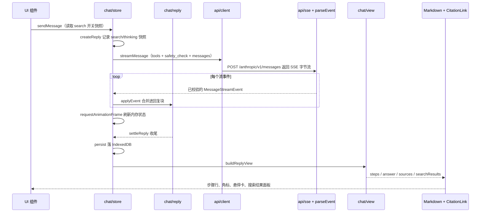

# chat-demo 联网能力实现走读（智能搜索 / 阅读链接）

> 一句话结论：**浏览器不抓网页。** 前端只做三件事——在请求里声明服务端工具、解析 SSE 流、把结果渲染成来源卡片与引用角标。搜索、抓取、正文加密都在 DeepSeek 服务端完成；客户端拿到的只是可展示的元数据和一段无法解密的密文。
>
> 官方文档：[联网工具](https://api-docs.deepseek.com/zh-cn/guides/web_tools/)、[Messages API](https://api-docs.deepseek.com/zh-cn/api/create-message/)、[使用 Anthropic API](https://api-docs.deepseek.com/zh-cn/guides/anthropic_api/)

---

## 1. 能力清单与开关

应用使用 Anthropic 兼容的 Messages API（`POST {API_ORIGIN}/anthropic/v1/messages`），通过两个**服务端工具**联网：

| 能力 | 请求中声明 | 触发条件 | 响应中的内容块 |
| --- | --- | --- | --- |
| 联网搜索 | `{type:'deepseek_web_search', name:'deepseek_web_search'}` | 设置项「智能搜索」打开 + 模型判断需要搜索 + 关闭思考 | `server_tool_use(action:'search', kind:'search')` + `web_search_tool_result` |
| 深度思考搜索（边想边搜） | 同上 | 同一开关 + 开启「深度思考」 | 多次 `search` / `open_page` / `find_in_page`，`kind` 为 `deep_search` |
| 图片搜索 | 同上 | 用户消息带图片，模型按图搜索 | `kind` 为 `image_search` / `deep_image_search`，`queries` 为空数组 |
| 阅读链接 | `{type:'deepseek_read_url', name:'deepseek_read_url'}` | **始终声明**；最后一条用户消息里有 URL 时由模型决定读不读 | `server_tool_use(action:'read_link')` + `web_fetch_tool_result` |

代码位置：

- 工具声明：`src/services/chat/store.ts:56` `serverTools(search)` —— `deepseek_read_url` 恒定加入，`deepseek_web_search` 只在开关打开时加入。
- 开关持久化：`src/services/settings.ts:96-98`（localStorage 键 `chat-demo:search`，默认关闭）、`src/services/settings.ts:132`。
- 开关 UI：`src/components/chatInput/ChatInput.tsx:217-228`，图标按钮 `aria-pressed={search}`。
- 请求快照：`src/services/chat/store.ts:264` `createReply()` 把当时的 `thinking` / `search` 写进每条 assistant 消息（`src/services/chat/types.ts:84` 注释），因此每条回答都带着自己那次的开关状态：**重新生成**按当前开关新建快照（`regenerateReply` → `createReply()`），**续写**优先沿用原回答的快照（`continueReply`，`store.ts:716-724`，缺省时用当前开关）。

另外两个常被忽略的请求字段（都在 `store.ts:1024-1035` 组装）：

- `safety_check: {level:'high'}` 恒定开启（`store.ts:49`）。按 `src/services/api/types.ts:4` 的注释，声明联网工具或设置 `safety_check.level='high'` 会让请求进入「扩展模式」，两者都属于「扩展字段」，可以和 `safety_check`、`title`、两个联网工具共存，但不能与其他服务端工具（如 `web_search_20250305`）同时声明（官方错误文案：`other tools cannot be used together with deepseek_web_search, deepseek_read_url, safety_check or title`）。
- `title: {enabled:true}` 只在会话还没有标题时附加，模型生成的标题通过 `message_delta.delta.title` 下发，由 `store.ts:1048-1052` 写入会话。

---

## 2. 端到端时序



关键点：**归并（reply.ts）负责数据正确性，视图（view.ts）是纯函数派生，渲染层不再解析协议。** 内容块始终原样保存，界面所需结构每次由块重新推导——所以续写追加、分支切换都不需要额外迁移逻辑。

---

## 3. 传输层：请求怎么发、流怎么读

`src/services/api/client.ts`

- `API_ORIGIN` 由构建期注入（默认 `https://api.deepseek.com`，见 `src/services/api/client.ts:14`），Anthropic 兼容前缀为 `${API_ORIGIN}/anthropic/v1`（`:16`）。想换网关/自建代理，改 `rspack.config.ts` 的 `apiOrigin` 即可，前端代码不用动。
- 鉴权：`x-api-key`（`:86-91`）。只有引用 Files API 的图片时才附加 `anthropic-beta: files-api-2025-04-14`（`hasFile()`，`:134-139`）；联网请求本身不需要 beta 头。
- `streamMessage()`（`:145-190`）：`POST /anthropic/v1/messages`，`stream:true`、`Accept: text/event-stream`；非 2xx 转成 `ApiError`，响应不是 `text/event-stream` 视为协议错误；逐个 yield `MessageStreamEvent`，收到 `message_stop` 结束（官方协议不发 `[DONE]`）。
- 流内错误：无名 `data` 帧或 `event: error` 帧只要形如 `{error:{message}}`，抛 `ApiError('stream')`（`:166-178`）。流在 `message_stop` 前断掉 → `ApiError('interrupted')`。
- 错误分类（`src/services/api/errors.ts:17-34`）：401 未授权、402 余额不足、413 过大、429 限流、≥500 服务端繁忙；上传重试只对网络/限流/繁忙三类做（`:47`）。

`src/services/api/sse.ts` 是按 WHATWG 规范手写的解码器，没有用 `EventSource`（需要 POST + 自定义头）：

- `ServerSentEventDecoder`（`:20-99`）：字节流 → UTF-8 解码（`TextDecoder` 增量，避免多字节字符跨分片截断，`:115`）→ 按 `\r\n|\r|\n` 切行 → `data` 多行用 `\n` 连接 → 空行派发。结尾的 CR 要等下一段再判断（`:35`），注释行 `: keep-alive` 忽略。
- `readServerSentEvents()`（`:105-136`）：`reader.cancel()` 与 `AbortSignal` 联动，提前退出时释放连接。

---

## 4. 协议层：内容块与流事件

类型全集在 `src/services/api/types.ts`，只保留本应用消费的部分。

### 4.1 请求侧相关类型

| 类型 | 位置 | 作用 |
| --- | --- | --- |
| `ServerToolUseBlock` | `types.ts:46-55` | 服务端工具调用；**原子下发**，`content_block_start` 就带完整 `input`；`id` 形如 `srvtoolu_{s|ds|rl|is|dis}_{序号}_{hex}`，`kind` 标明能力 |
| `WebSearchToolResultBlock` | `types.ts:80-86` | 通过 `tool_use_id` 关联调用；`content` 为结果数组或 `{type:'web_search_tool_result_error', error_code:'unavailable'}` |
| `WebSearchResult` | `types.ts:57-73` | `title/url/snippet/site_name/site_icon/page_age` 可见；`encrypted_content` 是 AES-256-GCM 密文，客户端解不开；`image_url` 仅保存不展示 |
| `WebFetchToolResultBlock` | `types.ts:107-114` | 阅读链接/打开网页的结果；`signature` 仅 `read_link` 成功时返回，是**多轮回传的凭据** |
| `WebFetchResult` | `types.ts:88-99` | `content.source.data` 恒为空串（正文不在块里），只有标题与日期用于展示 |
| `TextCitation` | `types.ts:12-21` | `type` 恒为 `web_search_result_location`；`cited_text` 是回答文本而非网页摘录；同一块内按 URL 去重 |
| `CreateMessageRequest` | `types.ts:175-183` | `model / system / messages / thinking / tools / safety_check / title?` |

### 4.2 流事件

`MessageStreamEvent`（`types.ts:213-234`）：`message_start` → 每个块 `content_block_start` / `content_block_delta` / `content_block_stop` → `message_delta` → `message_stop`，期间可能穿插 `ping`（被 `parseEvent.ts:227` 丢弃）。

一次「开启思考 + 搜索一次」的真实事件顺序（官方文档同款）：

```
message_start
content_block_start(thinking) → thinking_delta… → signature_delta → content_block_stop
content_block_start(server_tool_use)      → content_block_stop      ← 内容在 start 里就已完整
content_block_start(web_search_tool_result) → content_block_stop
content_block_start(thinking) → thinking_delta… → signature_delta → content_block_stop
content_block_start(text) → text_delta… → citations_delta… → content_block_stop
content_block_start(text) → text_delta… → content_block_stop
message_delta → message_stop
```

校验策略在 `src/services/api/parseEvent.ts`，核心思路是**只校验自己消费的字段，其余字段原样保留**（因为要回传）：

- `readBlock()`（`:23-148`）：按 `type` 分支校验；`server_tool_use` 要求 `kind` 属于五种之一、`name` 属于两个工具之一，并按 `input.action` 校验 `queries` / `url` / `pattern`（`:50-83`）；`web_search_tool_result` 过滤掉不认识的 result 项（`:94-113`）；`web_fetch_tool_result` 区分成功与错误体（`:114-140`）；`tool_use`（客户端工具）原样保留，但归并层 `toReplyBlock()` 不认它、直接丢弃，并因此关闭该回复的续写（见 `reply.ts:85-89`）。
- `readDelta()`（`:150-166`）：`text_delta` / `thinking_delta` / `signature_delta` / `citations_delta`；`input_json_delta` 未识别，直接丢弃。
- `readMessageEvent()`（`:175-231`）：认不出的事件返回 `null`，由调用方跳过，不影响后续正常内容与结束——服务端加字段不会打挂旧前端。

---

## 5. 归并层：把流折叠成一条消息

`src/services/chat/reply.ts`

### 5.1 `applyEvent()`（`:72-137`）

流里的事件索引是**本次响应内**的 `index`，而本地 `blocks` 是跨续写累积的数组，因此用一个临时映射 `blockIndexes: Map<number, number>`：

- `content_block_start`：`toReplyBlock()` 转换后追加到 `blocks` 尾部，记录 `serverIndex → blocks 下标`；重复的 index 会先 `delete` 再覆盖。`thinking` 块额外记录 `startedAt`。
- `content_block_delta`：从映射取本地下标，按块类型拼接 `text` / `thinking` / `signature` / `citations`（`citations` 是追加，不是覆盖）。
- `content_block_stop`：给 `thinking` 块补 `endedAt`，然后删除映射。
- `message_delta`：写 `stopReason` / `stopDetails` / `usage`。
- 首次事件会把 `status: 'pending'` 提升为 `'streaming'`。

### 5.2 `settleReply()`（`:143-160`）

结束（done/stopped/error）时收尾未闭合的思考块；**`stopReason === 'refusal'` 时丢弃所有 `thinking` 与 `text` 块，只保留工具块**——官方要求已下发的正文在拒答时不能展示。UI 侧 `AssistantMessage.tsx:51` 也做了同样的兜底。

### 5.3 刷新与落盘

`streamReply()`（`store.ts:987`）里每个事件都调用 `applyEvent`，但**不是每个事件都 setState**：用 `requestAnimationFrame` 合并刷新（`store.ts:1053-1059`），页面隐藏时立即 flush（同一处）；`finally` 里统一收尾、把 `streaming` 里对应的 AbortController 移除并 `persist()`。停止生成 = `controller.abort()`（`store.ts:549`），`streamMessage` 抛出 AbortError 后按 `stopped` 收尾。

### 5.4 续写

`continueReply` 复用同一条 assistant 消息，新流的内容**追加在已有块之后**——这正是 `blockIndexes` 必须重新映射的原因。协议上，使用过联网工具的回复**不允许续写**，所以 `canContinueReply()`（`:172-191`）见到任何 `server_tool_use` / `web_search_tool_result` / `web_fetch_tool_result` 直接返回 false，UI 不显示「继续生成」。

---

## 6. 视图层：从内容块推导界面

`src/services/chat/view.ts`（纯函数，不修改块）

### 6.1 两遍扫描

`buildReplyView()`（`:183-355`）先建 `tool_use_id → 结果块` 的 Map（`:184-189`），然后：

1. **第一遍只遍历 `server_tool_use`**（`:199-220`），把搜索结果和深度搜索打开的网页登记进 `SourceRegistry`，得到**稳定的编号顺序**（搜索结果、打开的网页在回复中出现的顺序，与正文引用先后无关）。
2. **第二遍按块顺序生成步骤时间线**（`:233-346`）。

### 6.2 来源登记与编号

`SourceRegistry`（`:109-152`）：

- 只接受 `isWebUrl()` 能解析的 URL，非 http(s) 直接丢弃。
- **同一 URL 只编号一次**；后到的结果只补齐缺失字段（标题、站点名、日期、摘要、图标），不覆盖已有信息（`:125-138`）。
- 站点名优先用服务端的 `site_name`，否则取域名去掉 `www.`（`getSiteName()`，`:82-88`）。
- `index` 从 1 开始，既用于结果卡片编号，也用于正文角标 `[citation:N]`。

### 6.3 步骤类型与聚合规则

| 步骤 | 触发块 | 聚合规则 |
| --- | --- | --- |
| `search` | `server_tool_use` + `action:'search'` | 普通搜索按 `kind` 聚合到首次出现的位置（`mergedSearch`）；深度思考搜索只合并**相邻且同 kind** 的调用（`:288-310`），保留「搜 → 开 → 找」的推理节奏 |
| `open` | `action:'open_page'` | 相邻打开合并成一行，最多展示 5 个页面，更多时给「查看全部」 |
| `find` | `action:'find_in_page'` | 相邻查找合并，逐个展示关键词状态 |
| `read_link` | `action:'read_link'` | **只在 `wip` 时展示**，读取完成/失败后从时间线隐藏（`:322-331`）；原始块保留用于后续请求 |
| `thinking` | 相邻 `thinking` 块 | 合并成一个可折叠段落，共用一个小标题 |
| `text` | 最后一个思考/工具块**之前**的正文 | 作为「工具前的说明文字」进时间线（`flushPreamble()`，`:222-231`） |

工具状态 `getStatus()`（`:90-103`）：有结果块 → 成功；结果块是错误项 → 失败；只有调用没有结果且仍在流式 → `wip`；流结束后仍没有结果 → 失败。`mergeStatus()`（`:105`）：任何一个 `wip` 就是 `wip`，全部失败才算失败。

### 6.4 正文与 `[citation:N]`

- `answer` 只包含**最后一个思考/工具块之后**的正文（`:348`）；模板提示块（`isTemplate`）完全跳过（`:234-237`）。
- 服务端在带引用的文本块之后另起新块，所以引用位置就是**块尾**。`joinTextBlocks()`（`:158-181`）把 `[citation:N]` 插在块尾空白之前：先 `trimEnd()` 拼正文，再插标记，最后补回被裁掉的空白。
- 找不到来源的角标在 Markdown 解析阶段会被删掉（见 §7）。
- `getTotalThinkingSeconds()`（`:358-375`）/ `getAreaTitle()`（`:378-408`）决定折叠标题：`已思考（用时 N 秒）` / `正在搜索` / `正在浏览网页` / `正在阅读` / `已停止`。`getAreaTitle` 依赖 `isImageSearchKind` / `isDeepSearchKind` 选择文案。

---

## 7. 渲染层：角标、悬停卡、步骤行、结果面板

| 界面元素 | 组件 | 数据来源 | 交互 |
| --- | --- | --- | --- |
| 正文角标 `N` | `src/components/search/CitationLink.tsx:10` | `[citation:N]` 节点携带的 `Source` | 悬停 300ms 显示来源卡（`HoverCard`）；点击新标签打开 |
| 正文 Markdown | `src/components/markdown/Markdown.tsx:14` | `answer.markdown` + `sources` | 节流渲染 → AST → React；`sources` 未变时复用数组，避免流式文本刷新拖慢 Markdown（`useReplyView.ts:18-32`） |
| 步骤时间线 | `src/components/messages/ReplyArea.tsx:56` | `view.steps` | 折叠/展开；`SearchRow` 点击打开结果面板；`OpenRow` 展示页面链接 |
| 搜索结果面板 | `src/components/search/SearchPanel.tsx:9` | `searchPanelState.ts` 的 `entry + sources` | 同一入口再次点击收起；换入口替换内容（`searchPanelState.ts:13-16`） |
| 底部「N 个网页」 | `src/components/messages/AssistantMessage.tsx:127-140` | `view.searchResults`（去重后的搜索来源） | 点击打开面板 |
| 站点缩略图 | `src/components/search/SiteLogo.tsx:31` | 来源的 `siteIcon` | 最多 4 个重叠图标，加载失败回退链接图标 |
| 来源卡 | `src/components/search/SourceCard.tsx:14` | `Source` | 站点图标/名称/日期/标题/摘要，整卡外链 |

Markdown 里角标的落地方式（两步，渲染阶段不再碰原文）：

1. `toMdAst()`（`src/services/markdown/parse.ts:34-60`）在解析后对文本节点做 `findAndReplace(/\[citation:(\d+)\]/g)`，用 `sourcesByIndex` 换成自定义 `citation` 节点；找不到来源就替换为空串。
2. `MarkdownAstRenderer.tsx:140` 把 `citation` 节点渲染成 `<CitationLink source={...}/>`；角标样式由 `markdown.css` 的 `.ds-markdown-cite` 提供。

> 注意：思考内容的 Markdown 只设 `disableLink`、不传 `sources`，所以思考里的 `[citation:N]` 不会被替换；最终回答和「工具前的说明文字」都会传 `sources`，其中的标记同样渲染成角标。

---

## 8. 多轮对话：回传策略（最容易踩坑的部分）

官方规则（[联网工具 - 多轮对话](https://api-docs.deepseek.com/zh-cn/guides/web_tools/#multi-turn)）：

- 每次请求携带完整历史；搜索**结果块**、打开的网页、之前轮次的思考**不会**进入后续上下文，只保留回答正文。
- 阅读链接的网页正文靠 `signature` 还原，**把那条 `web_fetch_tool_result` 原样回传**，服务端解密后拼到该轮用户消息末尾，模型后续才能引用。没有有效 `signature` 时网页不会拼回，但请求仍正常执行。
- 块里的 `url/title/data/published_at` 仅供展示，回传前改掉不影响结果。

代码实现：`toAssistantParam()`（`src/services/chat/reply.ts:223-284`），逐条对应：

| 块类型 | 处理 |
| --- | --- |
| `thinking` | 历史轮次不回传；`prefix`（续写）时保留本轮非空白思考及其 `signature`（`:244-246`、`:261-264`） |
| `text` | 去掉 `citations`（服务端忽略）；相邻文本直接拼接，被思考/工具隔开的文本用空行连接；跳过历史思考后仍保留前后正文的空行（`:247-259`） |
| `server_tool_use` | **只回传 `kind === 'read_link'`** 的调用，并跳过「结果缺 `signature`」的调用（`:265-271`） |
| `web_search_tool_result` | 不回传（`api/types.ts:143` 注释、`reply.ts:272-278` 只匹配 `web_fetch_tool_result`） |
| `web_fetch_tool_result` | **只回传 `kind === 'read_link'` 且签名有效的块**，`signature` 原样保留（`:272-278`）；深度思考搜索打开的网页（`kind:'deep_search'`）不回流 |
| `tool_use`（客户端工具） | 不保存、不回传，且该回复不可续写 |

配套约束：

- `isUsableReply()`（`:197-202`）：只有 `done`/`stopped`、非拒答、正文非空且不含模板提示的回复才进入上下文。
- `toRequestMessages()`（`:303-343`）：只保留「提问 + 可用回答」成对轮次；提问既无文字又无可引用附件时整轮省略；续写时末尾追加 assistant 前缀，若前缀只剩空白则省略（避免服务端拒绝空 prefill）。
- 历史 `latest_reminder` 快照只在首次出现或内容变化时插入（`:312-318`），避免每轮重复。
- `latest_reminder` 由 `src/services/chat/latestReminder.ts:19-30` 生成：`日期,星期,地区,Web,语言`，用浏览器本地时区，避免 UTC 跨日。它位于对应用户消息之前，需要服务端支持该扩展角色。

**为什么搜索结果不回传？** 结果里有 `encrypted_content`，客户端解不开、服务端也不采用，原样回传只会白占上下文 Token；而且服务端明确「搜索结果不进后续上下文」。所以后续轮次里，模型只能依赖自己上一轮写下的正文——这也意味着「让模型重看第 3 条来源」这类追问容易答不准：**要复用网页内容，必须读链接（read_link），不能靠搜索。**

---

## 9. 持久化与导入导出

- **本地存储**：`ReplyBlock[]` 原样 JSON 存进 IndexedDB（`src/services/chat/db.ts`，`DB_VERSION = 11`，`sessions` 存储主键 `id`）。签名、加密内容、`kind`、`caller` 都不裁剪——因为下次请求要用。视图数据（steps/sources）不落盘，每次从块重新推导。
- **导出**（`src/services/chat/history/toArchive.ts`）：内容块转成归档片段 `TOOL_SEARCH` / `TOOL_OPEN` / `TOOL_FIND` / `READ_LINK`（`toolFragment()`，`:47`）。`READ_LINK` 保留 `url/title/signature`；搜索片段保留 `queries/status/results`（`snippet/site_name/site_icon/published_at`）；`search_enabled` 写在消息级（`:251`）。导出时，本轮用过联网工具的回复还会从正文剥除模型原样输出的 `[citation:N]`（`assistantFragments()`，`:124-152`）。
- **导入**（`src/services/chat/history/toLocal.ts`）：`toBlocks()`（`:101`）反推内容块；归档不带调用 ID，用 `history-{messageId}-{index}` 生成稳定 ID，让调用与结果共用（`toolBlocks()`，`:47`）。**同一回复里出现 `TOOL_OPEN`/`TOOL_FIND` 就推断为 `deep_search`，否则为 `search`**（`:102-105`）——归档没有 `kind` 字段。导入的搜索结果是 `encrypted_content: ''`（本来就没有），签名原样保留；`search_enabled` 读入消息快照（`:221`，schema 校验在 `schema.ts:216`）。
- **既有损失**：导入归档无法恢复 `encrypted_content`（展示层本来也不用），但 `signature` 保留所以阅读链接的上下文仍可回传；`TOOL_OPEN` 没有 URL 时直接丢弃不展示（`toLocal.ts` 注释）。

---

## 10. 异常与边界

| 情况 | 表现 | 代码 |
| --- | --- | --- |
| 搜索失败 | 结果块为 `web_search_tool_result_error` → 步骤显示「联网搜索暂不可用」，`status:'failed'` | `view.ts:97-100`、`ReplyArea.tsx:222` |
| 搜索无结果 | `content: []` → 「未搜索到相关内容」 | `ReplyArea.tsx:225-226` |
| 抓取失败 | `url_not_accessible` / `url_not_allowed` / `unavailable` → `read_link` 行只在 wip 显示，失败后隐藏；深度搜索的页面显示「浏览失败」 | `types.ts:101-105`、`view.ts:322-331`、`ReplyArea.tsx:312` |
| 调用没有结果就断流 | 非流式 → `failed`；流式且仍在接收 → `wip`，标题保持「正在搜索/浏览」 | `view.ts:90-103`、`getAreaTitle()` |
| 断流（无 `message_stop`） | 若已收到 `message_delta.stop_reason` 视为完成，否则报错 | `store.ts:1088-1093` |
| 内容审核拒答 | `stop_reason:'refusal'` → 丢弃正文/思考，只保留工具块，展示拒答模板 | `reply.ts:143-160`、`AssistantMessage.tsx:51` |
| 用户停止 / 关闭页面 | `abort()` → `settleReply('stopped')`；页面关闭时未完成的回复按「已停止」处理 | `store.ts:549`、`store.ts:280-296` |
| 非 http(s) URL | 不进来源列表、不可点击 | `view.ts:119-121` |
| 同一 URL 多条结果 | 只编号一次，元数据互补 | `view.ts:125-138` |
| 只有签名没有 URL 的阅读结果 | 仍参与请求，但不展示链接 | `view.ts:260-271` |
| 使用过联网工具的回复 | 不提供「继续生成」（服务端会 400） | `reply.ts:172-191` |
| 附件与扩展模式 | `types.ts:130` 注释称「扩展模式不支持 document，返回 400」，但官方兼容性表明确写 `document` 在 user 消息中支持 `file`/`text` 来源——该注释可能已过时。本应用恒定 `safety_check:high`（必然处于扩展模式）且非图片附件用 `document` 块（`reply.ts:27`）；若带 PDF 的请求真的 400，这里是首要排查点 | `types.ts:130`、`reply.ts:22-32` |

另外两处值得记住的协议细节：

- `stop_reason: 'max_tokens'` 在联网场景里可能表示「搜索/阅读之后上下文用尽」，不一定只是输出被截断（官方文档）。
- 服务端工具**不计费**，只计模型 Token；`usage.server_tool_use` 是调用次数统计，流式以最后一个 `message_delta.usage` 为准。

---

## 11. 二次开发切入点

| 想做的事 | 改哪里 |
| --- | --- |
| 换 API 网关 / 自建代理 | `rspack.config.ts` 的 `createConfig({ apiOrigin, devServer })`，前端代码零改动 |
| 默认开启智能搜索 | `src/services/settings.ts:97` 的默认值，或设置页给用户一个显式开关 |
| 去掉「阅读链接」只留搜索 | `src/services/chat/store.ts:56` 的 `serverTools()` |
| 新增服务端能力（如仅图搜） | 没有独立开关——图搜属于 `deepseek_web_search`，只能通过「用户消息带图片」触发；若要按场景控制，需要在 `store.ts` 决策时限制是否声明工具 |
| 新增一种工具步骤的渲染 | `types.ts` 加块类型 → `parseEvent.ts` 校验 → `reply.ts:34` 保存 → `view.ts` 加 Step 类型与聚合 → `ReplyArea.tsx` 加行组件；**不要**在渲染层解析协议 |
| 自定义来源展示（比如加站点 favicon 代理） | `SourceRegistry.add()`（`view.ts:113`）与 `SiteLogo.tsx` |
| 复用同一份结果到别的协议（Responses / Chat Completions） | 参考官方文档对应章节，前端这层只需换 `client.ts` 的请求/解析，`reply/view/UI` 可复用 |

---

## 12. 手工验证（最快复现路径）

```bash
curl -N https://api.deepseek.com/anthropic/v1/messages \
  -H "content-type: application/json" \
  -H "x-api-key: $DEEPSEEK_API_KEY" \
  -d '{
    "model": "deepseek-flash",
    "stream": true,
    "thinking": {"type": "disabled"},
    "safety_check": {"level": "high"},
    "tools": [
      {"type": "deepseek_web_search", "name": "deepseek_web_search"},
      {"type": "deepseek_read_url", "name": "deepseek_read_url"}
    ],
    "messages": [{"role": "user", "content": "用一句话总结 https://example.com/ 的内容"}]
  }'
```

观察点：`server_tool_use` 的 `kind` 是 `read_link` 还是 `search`；`web_fetch_tool_result.signature` 是否存在；`text` 块的 `citations` 是否另起新块；最后 `message_delta.usage.server_tool_use` 的计数。

前端侧用 DevTools：

1. Network 面板找 `messages` 请求，看 Request Payload 的 `tools` 是否随开关变化、`safety_check` 是否恒为 high。
2. Response 是 SSE，逐帧核对上面的顺序。
3. React DevTools 里看 `AssistantMessage` 的 `message.blocks` prop；或在 Application → IndexedDB 的 `sessions` 里看落盘原始数据——两者一致。
4. 关掉搜索再问同一句话：`tools` 里只剩 `deepseek_read_url`，历史里已有的搜索块不会出现在请求体里（只看 `messages` 就懂为什么「搜索结果不跨轮」）。

---

## 13. 关键代码地图

| 文件 | 职责 | 先看哪几行 |
| --- | --- | --- |
| `src/services/api/types.ts` | 协议类型（请求/块/事件） | `46-114`、`163-183`、`213-234` |
| `src/services/api/client.ts` | 发请求、读 SSE、错误分类 | `86-100`、`145-190` |
| `src/services/api/sse.ts` | WHATWG SSE 解码 | `20-99`、`105-136` |
| `src/services/api/parseEvent.ts` | 事件校验/裁剪 | `23-148`、`175-231` |
| `src/services/chat/store.ts` | 工具声明、请求组装、流消费、落盘 | `56-64`、`264-273`、`987-1113` |
| `src/services/chat/reply.ts` | 事件归并、收尾、上下文回传 | `34-52`、`72-160`、`223-343` |
| `src/services/chat/view.ts` | 块 → 视图（步骤/正文/来源） | `109-181`、`183-355` |
| `src/services/chat/types.ts` | 本地消息模型（快照字段） | `46-106` |
| `src/services/settings.ts` | 开关与 localStorage | `22-31`、`90-99`、`132-135` |
| `src/components/chatInput/ChatInput.tsx` | 开关 UI | `204-229` |
| `src/components/messages/ReplyArea.tsx` | 步骤时间线渲染 | `185-394` |
| `src/components/messages/AssistantMessage.tsx` | 汇总行、正文、操作 | `47-78`、`127-140` |
| `src/components/markdown/parse.ts` | `[citation:N]` → AST 节点 | `34-60` |
| `src/components/search/*` | 角标、悬停卡、结果面板、来源卡 | `CitationLink.tsx:10`、`HoverCard.tsx:16`、`SearchPanel.tsx:9` |
| `src/services/chat/history/toArchive.ts` | 块 → 归档片段 | `47-122`、`251` |
| `src/services/chat/history/toLocal.ts` | 归档片段 → 块 | `47-63`、`101-160` |

---

## 附：与「类 Web 访问」能力的差异

这套实现给的是**服务端联网**，不是浏览器的「访问网页」：

- 没有前端 `fetch(url)`、没有 CORS 问题、没有 HTML 解析；网页正文从不进入客户端。
- 客户端拿不到完整正文（`data` 恒空），所以**不能**做「本地全文高亮」「导出网页原文」这类功能。
- 想实现真正的「前端可读网页」，得自己加一个抓取代理/后端（或用官方 [网页搜索与抓取 API](https://api-docs.deepseek.com/zh-cn/guides/search/)），属于另一个架构方向。
